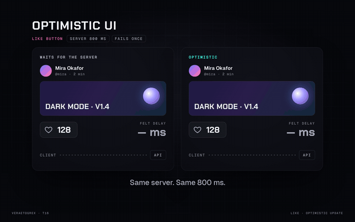

# Optimistic Like

**Same server. One like feels 800 ms slower.**



**Live demo:** [veraetogrex-portfolio.github.io/optimistic-like](https://veraetogrex-portfolio.github.io/optimistic-like/) · **Mockup:** [full-screen version](https://veraetogrex-portfolio.github.io/optimistic-like/mockup/optimistic-like.html)

Two identical like buttons on the same 800 ms server. The left one waits for the answer before showing anything. The right one shows the heart at once, sends the request in the background, retries a failed one and rolls back only if it never saves.

## Use it

Three files, no build step, no dependencies, no web fonts:

```
index.html   markup
style.css    styles and keyframes
script.js    behaviour
```

Download the repo and open `index.html`, or copy the three files into your project.

## Try it

- Click either heart. The left shows a spinner for 800 ms; the right fills instantly.
- The first optimistic request is set to fail, so you can see the quiet retry (500 · retry → 200 · saved).

## Make it yours

`LATENCY` and `RETRIES` at the top of `script.js` set the fake server delay and how many times the optimistic request retries before an honest rollback.

## What's in `mockup/`

The full 1440×900 screen this component was shot in for the reel:

- `mockup/optimistic-like.html` — interactive. `D` plays the demo, `R` resets.
- `mockup/optimistic-like.autoplay.html` — the scripted loop the reel was recorded from.
- URL flags: `?frame` puts the screen in a browser window, `?clean` hides the control panel, `?once` plays the demo once.

The mockup loads the same `style.css` and `script.js` from the root, plus a shared stage runtime and bundled fonts from `mockup/_shared/`. The component in the root doesn't need any of it.

---

Component 16 of a series. New one every day on Instagram [@veraetogrex_portfolio](https://www.instagram.com/veraetogrex_portfolio/) · all components: [github.com/veraetogrex-portfolio](https://github.com/veraetogrex-portfolio)

MIT licensed.
